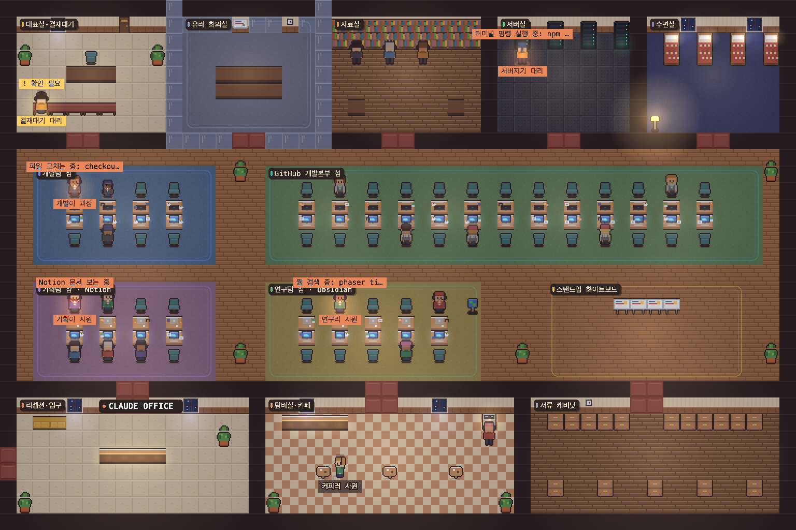
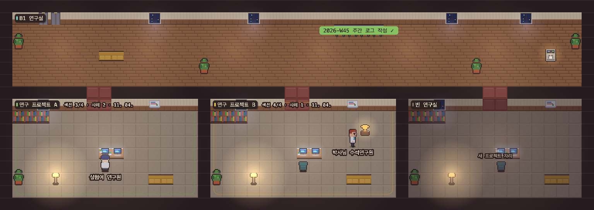

# Claude Office 🏢

내 컴퓨터에서 돌아가는 **Claude Code 세션들을 아늑한 픽셀아트 사무실**로 보여주는 로컬 대시보드예요.
서브 모니터에 띄워 두면, 세션이 지금 무슨 일을 하는지 직원들이 부서를 오가며 보여줍니다.



> 위 화면은 데모용 가짜 세션으로 찍었어요. 주황 배지를 단 직원이 지금 일하고 있는 실제 세션, 노란 "! 확인 필요"는 내 대답을 기다리는 세션이에요.

## 기능

- **세션 = 직원**: Claude Code 세션 하나가 직원 한 명. 하는 일에 따라 부서로 걸어가요.
  | 세션이 하는 일 | 가는 곳 |
  |---|---|
  | 파일 수정 (Edit/Write) | 개발팀 섬 |
  | 파일 읽기·검색 (Read/Grep) | 자료실 |
  | 터미널 명령 (Bash) | 서버실 |
  | 웹 검색, Obsidian 도구 | 연구팀 섬 |
  | Notion 도구 / GitHub 도구 | 기획팀 섬 / GitHub 개발본부 섬 (출장) |
  | 생각 중 | 유리 회의실 |
  | 내 승인·대답 대기 | 대표실 결재 대기 벤치 + 노란 "!" |
  | 작업 끝 / 30분 넘게 조용함 | 탕비실 / 수면실 |
- **한눈에 보이는 실제 작업**: 일하는 세션은 발밑 상태 링, 스포트라이트, 머리 위 "파일 고치는 중: app.ts" 같은 작업 표시가 붙어요.
- **커서를 올리면 말풍선**: 누가, 어느 부서에서, 무엇을 하는지.
- **역할 별명 + 직급**: "개발이 과장", "서버지기 대리"… 직급은 그 세션의 누적 도구 호출 수로 올라가요 (인턴 → 사원 → 대리 → 과장 → 부장).
- **서브에이전트 = 인턴**: 부모 옆자리에 앉아요.
- **배경 직원**: 사무실이 텅 비지 않게, 실제 세션과 별개로 일하고 커피 타러 다니는 직원들 (설정에서 끄기 가능).
- **B1 연구실 층**: `research-log` 폴더의 프로젝트 기록을 방으로 보여주고, 주간 로그 초안을 만들어 줘요.
- **스탠드업**: 정해진 시각마다 화이트보드 앞에 모여요.
- 화면 반쪽 분할(세로로 긴 창)에서도 맵 전체가 보이게 자동 맞춤.



## 개인정보와 보안

- **모든 데이터는 이 컴퓨터에만 있어요.** 서버는 `127.0.0.1`에만 열리고, 수집한 내용은 메모리에만 두며 어디에도 보내지 않아요.
- Claude Code 세션 기록(`~/.claude/projects`)과 research-log 는 **읽기만** 해요. (예외: 연구실의 "주간 초안 만들기"를 누르면 `weekly/YYYY-Www.draft.md` 하나를 써요. 최종본은 건드리지 않아요.)
- 토큰은 `.env`에만 저장되고 서버 안에서만 써요. 브라우저로 보내는 설정에는 토큰과 경로가 빠져요.
- 외부로 나가는 요청은 켜 둔 부서의 **읽기 조회**뿐이에요: GitHub(GraphQL 조회), Notion(검색 API).
- 토큰은 **읽기 전용** 권한으로 만드는 것을 권장해요.
- 훅을 등록하면 세션 id·이벤트 이름·도구 이름만 로컬 서버로 보내요 (프롬프트·파일 내용 X).

## 설치

필요: Node.js 18+, Claude Code

```bash
git clone https://github.com/Seung1won-dot/OFFICE.git claude-office
cd claude-office
npm run setup     # 대화형: 쓸 부서·토큰·경로 입력, 훅 등록(선택), 화면 빌드
npm start         # → http://localhost:4747
```

`npm run setup` 없이 바로 써도 돼요: `npm run build && npm start` (Claude 세션 + GitHub(gh 로그인 시) + 연구실만 켜짐).

| 명령 | 하는 일 |
|---|---|
| `npm run setup` | 대화형 설정 (`config.json`, `.env` 생성, 훅 등록 선택) |
| `npm run build` | 화면 빌드 (`web/dist`) |
| `npm start` | 서버 실행 |
| `npm run dev` | 화면 개발 서버 (Vite, 5173 → API 는 4747 로 프록시) |
| `npm run uninstall-hooks` | `~/.claude/settings.json` 에서 Claude Office 훅만 제거 (백업 후) |
| `npm run check-secrets` | 공개 전 점검: 토큰 패턴·개인 절대 경로·이메일 검출 |
| `npm run draft` | 이번 주 주간 로그 초안 만들기 |

### 키보드

`Tab` 층 전환 · `1`~`9` 첫 직원을 부서로 보내 보기 · `F` 전체화면

## 부서 연결 (선택)

부서마다 독립된 collector 라서, 토큰이 없으면 그 부서만 "부재중"으로 표시되고 나머지는 정상 동작해요.
켜고 끄기는 `config.json` 의 `collectors` 에서.

### GitHub 개발본부
- 방법 1: [gh CLI](https://cli.github.com/) 로 로그인되어 있으면 그대로 동작해요.
- 방법 2: **Fine-grained personal access token** (Settings → Developer settings → Fine-grained tokens)
  - Repository access: 보여줄 저장소 선택
  - Permissions: **Contents: Read-only, Metadata: Read-only, Pull requests: Read-only, Commit statuses: Read-only** (모두 읽기 전용)
  - `.env` 에 `GITHUB_TOKEN=...`

### 기획팀 (Notion)
1. https://www.notion.so/profile/integrations 에서 **Internal Integration** 생성, 권한은 **콘텐츠 읽기만**.
2. ⚠️ **보고 싶은 페이지마다 연결해야 해요**: 페이지 오른쪽 위 `···` → `연결` → 만든 Integration 추가. 연결 안 한 페이지는 보이지 않아요.
3. `.env` 에 `NOTION_TOKEN=...`, `config.json` 에서 `"notion": true`.

화면에는 오늘/이번 주 수정된 페이지 수만 보여요 (제목·본문은 안 보냄).

### 연구팀 (Obsidian)
- API 없이 볼트 폴더를 읽기만 해요. `.env` 에 `OBSIDIAN_VAULT_PATH=~/Documents/MyVault`, `config.json` 에서 `"obsidian": true`.

### B1 연구실 (research-log)
`config.json` 의 `research.path` (기본 `~/research-log`). 폴더가 없으면 아래 구조와 템플릿을 만들어 줘요.

```
research-log/
├── README.md          # 전체 타임라인
├── projects/*.md      # 프로젝트별 기록 (파일 1개 = 방 1개, projects/_TEMPLATE.md 복사해서 시작)
├── weekly/YYYY-Www.md # 주간 로그
└── claude-usage.md
```

- 이번 주 주간 로그에 프로젝트 이름이 나오면 → 연구원이 일하는 중, 없으면 조용함, 2주 넘으면 잠, `status: done` 이면 트로피.
- **공개 모드**(연구실 패널의 체크박스 또는 `research.publicMode`)를 켜면 프로젝트명이 "연구 프로젝트 A, B…"로 익명화돼요.
- 프로젝트 frontmatter 의 `claude_project_path` 를 채우면 주간 초안에서 그 경로의 Claude 세션들이 프로젝트별로 묶여요.

## 설정 (`config.json`)

`config.example.json` 참고. 주요 항목:

| 키 | 설명 |
|---|---|
| `collectors` | 부서별 켜기/끄기 |
| `zones` | 세션 상태 → 부서 매핑 |
| `tripKeywords` | 도구 이름 키워드(대소문자 무시) → 출장 갈 부서 |
| `debounce.minStaySec` / `quickToolSec` | 한 자리 최소 체류 시간 / 이 시간 안에 끝나는 호출은 이동 없이 아이콘만 |
| `standup.times` / `durationMin` | 스탠드업 시각과 길이 |
| `ambientStaff` | 배경 직원 수 (0 = 끔) |
| `research.path` / `publicMode` | 연구실 폴더 / 익명화 |

## 그림과 에셋

모든 타일·가구·캐릭터는 **코드로 직접 그린 픽셀아트**예요 (`web/src/gfx/`). 외부 에셋 없이 동작해요.
다른 타일셋을 쓰고 싶으면 `assets/README.md` 를 보세요 (재배포 불가 에셋은 `assets/third-party/` 에 직접 넣는 방식, 깃에는 안 올라감).

## 구조

```
server.js            로컬 서버 (의존성 없음)
lib/                 설정 로딩, 훅 설치/제거
collectors/          부서별 데이터 수집기 (플러그인) — 새 부서 추가는 CONTRIBUTING.md
hooks/office-hook.js Claude Code 훅 → 로컬 서버
scripts/             setup, uninstall-hooks, check-secrets
web/                 화면 (Vite + TypeScript + Phaser 3)
  src/map/           코드로 만드는 Tiled 형식 맵 (public/maps/office.tmj 를 넣으면 그걸 우선 사용)
  src/gfx/           타일셋·캐릭터·조명
  src/scenes/        1F 사무실, B1 연구실
```

## 라이선스

[MIT](LICENSE). 사용한 라이브러리와 에셋은 [CREDITS.md](CREDITS.md).
